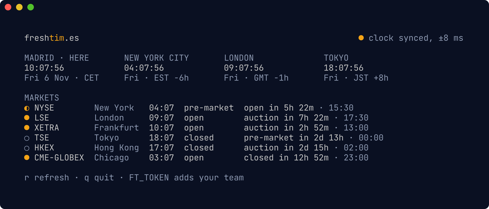
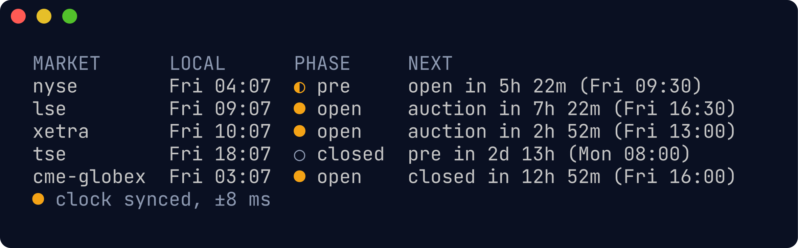
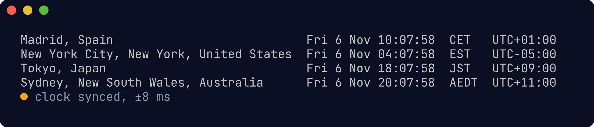

# ft

`ft` is the command line for [Freshtimes](https://freshtim.es): exact time with its error bound,
market hours and phases, overlap windows, time conversion, holidays and, with a token, who on your
team is working. Every answer comes from freshtim.es; `ft` runs no server of its own.

```sh
brew install arenzana/tap/ft
```

Builds for macOS and Linux (arm64 and amd64) are on the
[releases page](https://github.com/arenzana/freshtimes-cli/releases).

## The board

Run `ft` on its own for a live board: your clock and a few others, the markets you watch, and your
team when you pass a token. Clocks and countdowns tick every second; press `r` to refresh, `q` to quit.



```sh
ft board Madrid Tokyo --markets nyse,lse,cme-globex
```

## Commands

```sh
ft now Madrid "New York" Tokyo Sydney       # exact time, with the error bound
ft markets nyse lse xetra tse cme-globex    # phase now and what changes next
ft events --hours 36 nyse tse               # opens, closes, auctions, breaks, holidays
ft window lse nyse --zone Madrid            # when both are open today
ft convert 2026-11-05T15:00 --from Madrid "New York" Sydney
FT_TOKEN=ft_pat_... ft who --team Ops       # who is working, from your synced teams
```





Add `--json` for machine-readable output. Piped output is plain text without colour, and `NO_COLOR`
is honoured.

## Agents (MCP)

Connect to the remote MCP server directly, or use `ft mcp` for clients that only speak stdio (it
relays to the same server). A personal access token from Settings adds the team tools.

```sh
claude mcp add --transport http freshtimes https://freshtim.es/mcp
claude mcp add freshtimes -e FT_TOKEN=ft_pat_... -- ft mcp
```

[`skills/freshtimes`](skills/freshtimes/SKILL.md) teaches an AI agent when and how to use `ft` and
the MCP server. For Claude Code, copy the folder into `~/.claude/skills/`.

This repo holds releases only; issues and source are not public.
